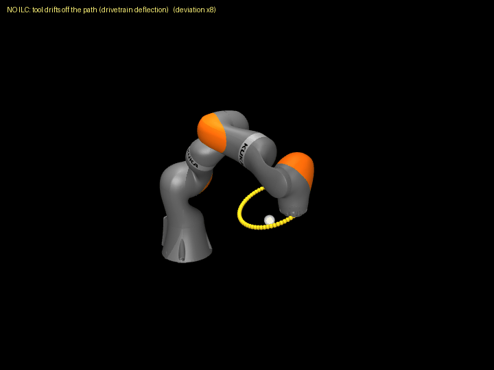
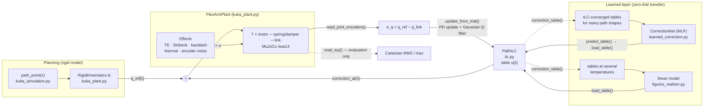
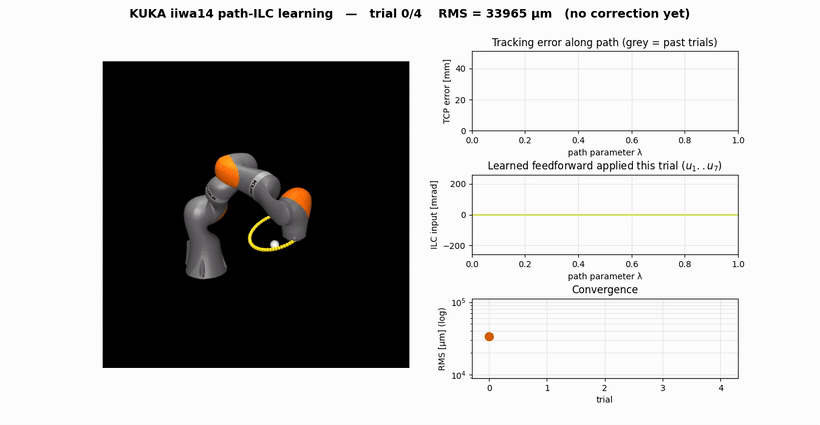
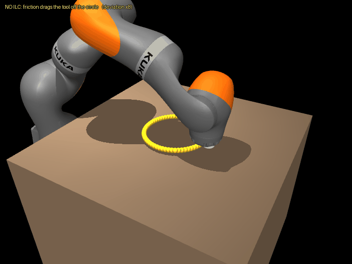
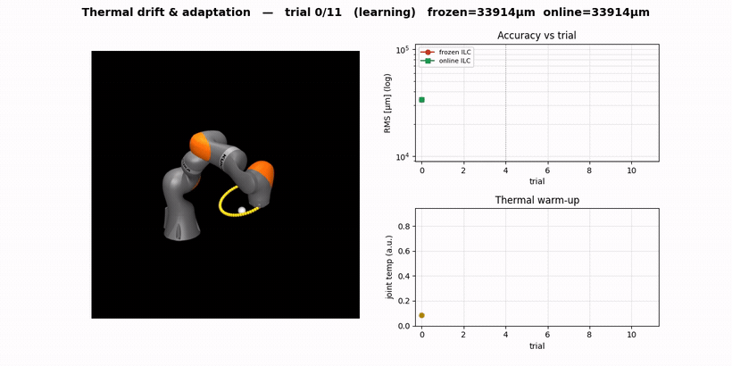
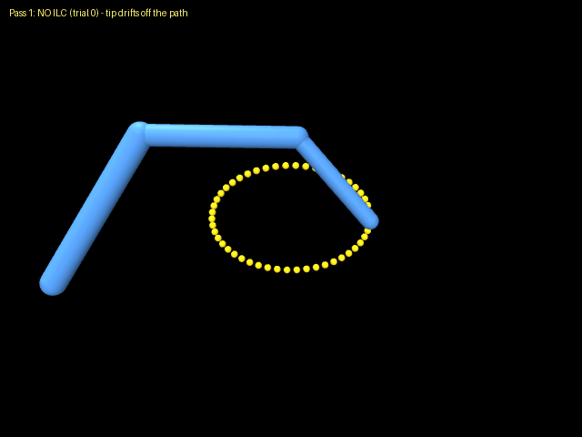

# Path-ILC with a learned correction layer for a flexible-joint KUKA iiwa14

A MuJoCo study that re-implements a path-parameter iterative learning controller
(ILC) on a KUKA iiwa14 with modelled flexible joints, then adds a small learned
layer that transfers the correction to unseen paths and thermal states.



*Tool-tip trace before ILC (red) and after ILC (green). The deviation from the
yellow desired path is amplified ×8 so that millimetre errors on a ~1 m arm are
visible.*

---

## Problem and key result

The absolute accuracy of industrial robots is limited by unmodelled
**drivetrain error**: joint elasticity, gear transmission error, friction,
backlash and thermal drift. Schwegel & Kugi (ICRA 2024) cancel this error with a
path-parameter PD-ILC and a Gaussian Q-filter, but they learn from an external
laser tracker and list several open problems: generalising the learned data to
**new paths**, **contact** tasks, and combining the ILC with a **model-based
learning filter**.

This project rebuilds every axis of the MuJoCo Menagerie iiwa14 as a two-mass
flexible joint (motor — torsional spring/damper — link), optionally adds
transmission error, Stribeck friction, backlash, thermal drift and encoder
noise, and runs the same path-ILC from a **joint-side (output) encoder**. The
true tool position is used for evaluation only.

**Key result (Cartesian RMS error at the tool, under transmission error +
Stribeck friction + backlash + encoder noise):**

- The path-ILC reduces the error from **34 156 µm to 1 061 µm (~32×)**, most of
  it in the first 2–3 trials.
- On a path it has never seen, a small neural network predicts a correction
  with **zero trials**: 34 594 µm (no correction) → 5 736 µm (reusing the base
  table) → **1 461 µm**.
- At an unseen thermal state, a temperature-indexed linear model gives
  **988 µm** against 4 508 µm for a frozen table and 1 050 µm for re-learning.

> **Sensing assumption.** The joint-side encoder here reads the true link angle,
> so it observes the drivetrain deflection directly. That is a *stronger* sensor
> than the motor-side encoders of the robot in the paper, which is why the paper
> needs a laser tracker. See [Limitations](#limitations).

---

## Architecture

How the pieces in `src/` fit together during one trial and across trials:



- `run_trial` in `kuka_simulation.py` executes one trial: it holds each path
  point for `hold` physics steps, commands `q_ref + u[λ]` to the motors and
  records the joint-side error for the ILC and the true TCP error for
  evaluation.
- The ILC table is indexed by the path parameter λ, not by time, so the same
  table can be reused at a different traversal speed.
- `contact_simulation.py` uses the same plant with a worktable and a tool-tip
  sphere. `toy_arm.py` / `toy_simulation.py` are a 3-DOF planar version that
  shares `ilc.py` and `learned_correction.py`.

---

## Tested versions

Verified on Linux (x86-64) with:

| Package | Version |
|---|---|
| Python | 3.13.16 |
| mujoco | 3.9.0 |
| numpy | 2.4.6 |
| matplotlib | 3.10.9 |
| torch | 2.12.0 |
| robot_descriptions | 2.0.0 |

The KUKA model is fetched at first use by `robot_descriptions` (a git clone of
MuJoCo Menagerie), so the first run needs network access.

---

## Install

```bash
git clone <this-repo-url>
cd <repo>
python3 -m venv .venv
source .venv/bin/activate
pip install -r requirements.txt
```

## Run

Run everything from the repository root. Figures are written to `outputs/`.

```bash
python src/run_all.py --quick      # all experiments and figures, no videos
```

On the test machine above this finished 5/5 scripts in about 3 minutes
(176 s). The individual scripts are:

```bash
python src/experiments_kuka.py     # convergence, speed reuse, path transfer, neural net
python src/experiments_contact.py  # contact task (tool pressed on a worktable)
python src/figures_analysis.py     # trial-wise overview, encoder validation, modal analysis
python src/figures_realism.py      # realistic-effect ablation, Q-filter, thermal drift
python src/experiments_toy.py      # 3-DOF toy arm
```

All of the commands above were run headless and completed successfully.

**Videos (not verified headless).** The render and dashboard scripts set
`MUJOCO_GL=glx` and need a display with OpenGL:

```bash
python src/run_all.py              # everything, including GIFs and MP4s
python src/render_kuka.py          # outputs/kuka_tracking.gif  (--live opens a viewer)
python src/render_contact.py       # outputs/kuka_contact.gif   (--live)
python src/render_toy.py           # outputs/toy_arm_tracking.gif (--live)
python src/dashboard_learning.py   # outputs/kuka_learning_dashboard.mp4
python src/dashboard_thermal.py    # outputs/kuka_thermal_dashboard.mp4
```

The GIFs in `media/` are committed copies of these outputs.

---

## Results

All values are Cartesian RMS errors at the tool. The KUKA experiments run with
`Effects.realistic_repeatable()` (transmission error, Stribeck friction,
backlash and encoder noise). Values shift slightly between runs (learning and
physics); on one machine with the pinned versions they repeat.

| Experiment | Result |
|---|---|
| ILC convergence (joint-side encoder only) | 34 156 → 1 061 µm (~32×) |
| Speed reuse (same table, other speeds) | best at the trained speed (≈ 997 µm), only partial elsewhere |
| Path transfer without the learned layer | no correction 42 016 → reuse base table 14 111 → re-learn 1 663 µm |
| Neural net, unseen path, 0 trials | no correction 34 594 → reuse base table 5 736 → **NN 1 461 µm** |
| Contact task (~108 N press) | 18 065 → 1 055 µm (~17×) |
| Thermal drift, unseen thermal state, 0 trials | frozen 4 508 → **learned 988 µm** (re-learn: 1 050 µm) |
| Encoder vs true TCP error over trials | correlation ≈ 0.97 |
| Toy 3-DOF arm, unseen path, 0 trials | 52 190 → reuse base table 39 999 → NN 4 165 µm |

| ILC convergence | Neural net on an unseen path |
|---|---|
|  |  |

| Contact task | Temperature-aware learned layer |
|---|---|
|  |  |

Learning dashboard (trials 0 → 4: arm, error vs λ, the seven ILC signals,
convergence):



<details>
<summary>More figures</summary>

| Figure | What it shows |
|---|---|
|  | Joint-side encoder RMS and true TCP RMS fall together (corr ≈ 0.97); the learned feed-forward follows the true drivetrain error. |
|  | Paper-style trial-wise plot: TCP error, ILC inputs and path speed; trial 5 switches the ILC off, trial 6 back on. |
|  | Reusing the table at other speeds: best at the trained speed. |
|  | Reusing a table on a different path barely helps; re-learning costs trials. |
|  | Error along the path, before vs after learning. |
|  | Joints as torsional spring–mass–dampers: f_n ≈ 10–195 Hz vs the 5 Hz Q-filter cutoff. |
|  | The ILC stays near 1.0–1.1 mm with each realistic effect enabled. |
|  | Without the Gaussian Q-filter the ILC learns encoder noise. |
|  | Injected angle-periodic transmission error (0.3–0.8 mrad, 13–37 cycles/rev). |
|  | Thermal drift: a frozen table degrades as the robot warms; an online ILC keeps up. |
|  | Contact task animation (trace deviation ×8). |
|  | Warm-up dashboard: frozen vs online RMS as joint temperature rises. |
|  | 3-DOF toy arm before vs after ILC. |

</details>

A four-page technical report and a two-page summary are in
[`technical_report/`](technical_report/), built from the sources in
[`latex_assets/`](latex_assets/).

---

## Limitations

- **Simulation only.**
- **Generous sensing.** The joint-side encoder reads the true link angle and
  therefore sees the very error the ILC learns. A real secondary encoder has
  noise and resolution limits, and kinematic errors (link lengths etc.) are
  invisible to any joint-side sensor. The optional encoder noise and
  quantisation do not model that calibration gap.
- **With a perfect link encoder, feedback is an alternative.** The value of the
  ILC here is the reusable, path-indexed feed-forward and the transfer built on
  top of it.
- **Simplified error sources** with parameters chosen for this study.
- **Partial speed transfer.** A position-indexed table cannot cancel a
  velocity-dependent residual, and the position controller used here is weaker
  than the computed-torque controller in the paper.
- **The learned-layer task is easy.** The path family is smooth, so a small
  network suffices; the contribution is the protocol (train on ILC-solved
  tables, test on an unseen geometry), not the difficulty of this instance.

---

## Repository layout

```
.
├── src/
│   ├── ilc.py                  # path-parameter PD-ILC + Gaussian Q-filter
│   ├── learned_correction.py   # geometry → correction-table MLP
│   ├── kuka_plant.py           # flexible-joint iiwa14, Effects, rigid kinematics
│   ├── kuka_simulation.py      # 3D path library, IK chain, trial loop
│   ├── contact_simulation.py   # worktable contact task
│   ├── toy_arm.py              # 3-DOF planar MuJoCo arm
│   ├── toy_simulation.py       # toy path library and trial loop
│   ├── experiments_*.py        # experiments → outputs/*.png
│   ├── figures_*.py            # analysis and realistic-effect figures
│   ├── render_*.py             # GIF renderers / live viewers
│   ├── dashboard_*.py          # MP4 dashboards
│   ├── plot_style.py           # shared matplotlib style
│   └── run_all.py              # regenerate everything
├── outputs/                    # generated figures (PNG)
├── media/                      # demo GIFs used in this README
├── latex_assets/               # LaTeX/TikZ sources for the report and summary
├── technical_report/           # compiled PDFs
├── requirements.txt
├── CITATION.cff
└── LICENSE
```

---

## References

1. M. Schwegel and A. Kugi, "A Simple Computationally Efficient Path ILC for
   Industrial Robotic Manipulators," in *Proc. IEEE International Conference on
   Robotics and Automation (ICRA)*, 2024, pp. 2133–2139.
   doi: [10.1109/ICRA57147.2024.10610623](https://doi.org/10.1109/ICRA57147.2024.10610623)
   — the method re-implemented in `src/ilc.py`.
2. B. Bischof, T. Glück, M. Böck, and A. Kugi, "A Path/Surface Following Control
   Approach to Generate Virtual Fixtures," *IEEE Transactions on Robotics*,
   vol. 34, no. 6, pp. 1577–1592, 2018.
   doi: [10.1109/TRO.2018.2861913](https://doi.org/10.1109/TRO.2018.2861913)
   — background on path-indexed control.

Further references (ILC survey, gear vibration, elastic-joint modelling,
friction, MuJoCo) are listed in the technical report.

## Acknowledgements

- The path-ILC algorithm is that of M. Schwegel and A. Kugi (reference 1).
- The KUKA LBR iiwa14 model comes from
  [MuJoCo Menagerie](https://github.com/google-deepmind/mujoco_menagerie)
  (Google DeepMind, Apache-2.0) and is fetched at runtime, not redistributed.
- TODO: name any collaborators who contributed to this project.

## Licence

MIT; see [LICENSE](LICENSE). To cite this project, see [CITATION.cff](CITATION.cff).
